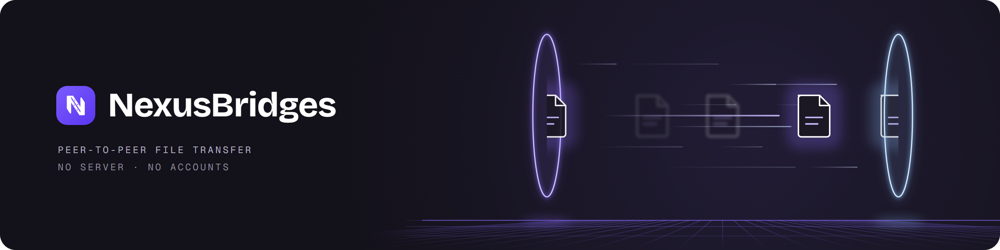

# NexusBridges

Pasa un archivo de uno de tus ordenadores a otro sin pendrive, sin nube y sin cuentas. De igual a igual, por tu red local, para Windows.

[](https://github.com/Davidstron23/nexusBridges/actions/workflows/ci.yml)
[](https://github.com/Davidstron23/nexusBridges/releases/latest)

**Estado:** temprano pero usable. La versión 0.1.0 envía archivos sueltos entre PC con Windows. Las carpetas, los envíos de varios archivos y el arrastrar y soltar están en desarrollo. Licencia Apache-2.0.

[Read in English](README.md)

## Qué hace

- Encuentra sola los otros dispositivos con NexusBridges de tu red, y tiene una búsqueda manual por si acaso.
- Vincula dos dispositivos una sola vez, con un código de 6 cifras que comparas en las dos pantallas. Un dispositivo que nunca vinculaste no puede enviarte nada.
- Envía el archivo directamente al otro dispositivo, cifrado, y lo comprueba con SHA-256 antes de darlo por bueno.
- Lo que llega de tus propios dispositivos entra sin preguntar; lo de un dispositivo que marcaste como de otra persona necesita tu confirmación cada vez.
- Solo funciona en las redes que apruebas.
- Nunca abre ni ejecuta lo que recibe, nunca sobrescribe un archivo y marca todo lo recibido como descargado de otro equipo, igual que hace Windows con lo que bajas del navegador.

## Por qué no otra cosa

- **Una nube o mandarte un correo a ti mismo** sube el archivo a internet y lo vuelve a bajar, y necesita una cuenta. NexusBridges va de un dispositivo al otro dentro de tu red, y nada sale de ella.
- **[LocalSend](https://github.com/localsend/localsend)** es maduro, funciona en móviles, macOS y Linux, y te deja enviar a cualquiera que esté cerca. Si hoy necesitas algo de eso, usa LocalSend. NexusBridges de momento es solo para Windows y está pensado para tus propios dispositivos: vinculación única, los no vinculados se ignoran y un trato más estricto de lo que llega.

## Instalar

Necesitas Windows 10 u 11 (64 bits) en los dos ordenadores, conectados a la misma red.

1. Descarga `NexusBridges-Setup-<versión>.exe` de la [última versión](https://github.com/Davidstron23/nexusBridges/releases/latest). Para comprobarlo, compara su huella con `SHA256SUMS.txt` de esa misma versión:

   ```powershell
   Get-FileHash .\NexusBridges-Setup-0.1.0.exe -Algorithm SHA256
   ```

2. Ejecútalo. Pide permisos de administrador una vez, para instalarse en `C:\Program Files\NexusBridges` y añadir dos reglas al Firewall de Windows (puerto 53530 TCP y UDP, solo desde tu subred local). Al desinstalarlo se borran.
3. El instalador todavía no está firmado, así que SmartScreen puede mostrar "Windows protegió su PC". Elige **Más información** y luego **Ejecutar de todas formas**.

Repite en el segundo ordenador, abre la app en los dos, aprueba tu red cuando te lo pregunte, vincula los dos dispositivos y envía un archivo. La primera vez que llega algo, la app te pregunta dónde guardarlo y te sugiere `Descargas\NexusBridges`.

## Seguridad

Cada dispositivo crea su propio certificado la primera vez que se abre (una clave EC P-256 protegida con DPAPI de Windows), y la clave nunca sale del dispositivo. Todo el tráfico va por TLS con autenticación mutua y huellas fijadas, y la app solo escucha en las redes que aprobaste. Lo recibido se escribe en una carpeta temporal oculta, se verifica y solo entonces se mueve a su destino.

Para avisar de una vulnerabilidad, mira [SECURITY.md](SECURITY.md).

## Compilar desde el código

Necesitas Git, Flutter (la versión exacta que fija `apps/nexus_bridges/pubspec.yaml`) y Visual Studio Build Tools 2022 con la carga de trabajo "Desarrollo para el escritorio con C++". Para generar el instalador también hace falta [Inno Setup 6](https://jrsoftware.org/isinfo.php).

```powershell
git clone https://github.com/Davidstron23/nexusBridges.git
cd nexusBridges
powershell -File tool/bootstrap.ps1
cd apps/nexus_bridges
flutter run -d windows
```

`bootstrap.ps1` comprueba la versión de Flutter, descarga las dependencias y activa los hooks de git. Para los tests, `dart test` en `packages/nexus_bridges_core` y `flutter test` en `apps/nexus_bridges`. Para generar el instalador, `powershell -File tool/build-installer.ps1`; lo deja en `installer/Output/`.

## Cómo está hecho

- El núcleo (`packages/nexus_bridges_core`) es Dart puro, sin Flutter: el descubrimiento, la vinculación, el servidor HTTPS y las transferencias viven ahí, y la app solo lo llama. Un test impide que las fronteras entre módulos formen ciclos.
- El código de red se prueba con sockets reales en `127.0.0.1`, sin simular la capa de red, incluidos los casos de seguridad: huellas desconocidas, rutas con `../` y archivos cuyo hash no cuadra.
- Todo cambio entra por un pull request. El CI revisa el formato, el análisis estático y las dos baterías de tests, y busca secretos filtrados en todo el historial con gitleaks.
- Se desarrolla con ayuda de IA. Claude escribe buena parte del código y figura como coautor en los commits con el trabajo más complejo; las specs, las decisiones de diseño, la revisión y cada merge son míos.

## Hoja de ruta

- **En desarrollo:** enviar carpetas enteras y varios archivos a la vez, arrastrar y soltar desde el Explorador, colas de envío y una bandeja "Para enviar".
- **Después:** elegir la carpeta de destino en el otro dispositivo, carpetas compartidas por dispositivo, una pantalla de ajustes y la bandeja del sistema.
- **Más adelante:** Android y luego iPhone.
- **Sin planes por ahora:** envíos por internet y reanudar transferencias cortadas.

En el [changelog](CHANGELOG.md) está lo que trae cada versión.

## Licencia

Apache License 2.0. Mira [LICENSE](LICENSE) y [NOTICE](NOTICE).

## Agradecimientos

[LocalSend](https://github.com/localsend/localsend) demostró que este tipo de app puede ser sencilla y abierta. NexusBridges es un proyecto aparte, escrito desde cero en Dart, con su propio protocolo.
