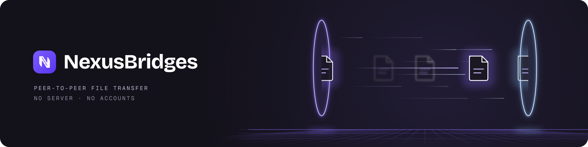

# NexusBridges

Move a file from one of your computers to another without a USB stick, a cloud drive or an account. Peer to peer, over your local network, for Windows.

[](https://github.com/Davidstron23/nexusBridges/actions/workflows/ci.yml)
[](https://github.com/Davidstron23/nexusBridges/releases/latest)

**Status:** early but usable. Version 0.1.4 sends files and whole folders between Windows PCs, with queues, drag and drop, a system tray and the choice of the destination folder on the other PC. Licensed under Apache-2.0.

[Leer en castellano](README.es.md)

## What it does

- Finds the other NexusBridges devices on your network on its own, with a manual search as a fallback.
- Pairs two devices once, with a 6-digit code that you compare on both screens. Devices you never paired cannot send you anything.
- Sends a file straight to the other device, encrypted, and checks it with SHA-256 before keeping it.
- Lets files from your own devices arrive without asking, while a device you marked as someone else's needs your confirmation every time.
- Only works on the networks you approve.
- Never opens or runs what it receives, never overwrites a file, and marks every received file as downloaded from another computer, as Windows does for browser downloads.

## Why not something else

- **A cloud drive or emailing yourself** sends the file to the internet and back and needs an account. NexusBridges goes from one device to the other inside your network, and nothing leaves it.
- **[LocalSend](https://github.com/localsend/localsend)** is mature, works on phones, macOS and Linux, and lets you send to anyone nearby. If you need any of that today, use LocalSend. NexusBridges is Windows only for now and is built around your own devices: a one-time pairing, unpaired devices ignored, and stricter handling of what arrives.

## Install

You need Windows 10 or 11 (64-bit) on both computers, connected to the same network.

1. Download `NexusBridges-Setup-<version>.exe` from the [latest release](https://github.com/Davidstron23/nexusBridges/releases/latest). To check it, compare its hash with `SHA256SUMS.txt` from the same release:

   ```powershell
   Get-FileHash .\NexusBridges-Setup-0.1.4.exe -Algorithm SHA256
   ```

2. Run it. It asks for administrator rights once, to install into `C:\Program Files\NexusBridges` and to add two Windows Firewall rules (TCP and UDP port 53530, only from your local subnet). Uninstalling removes them.
3. The installer is not code-signed yet, so SmartScreen may show "Windows protected your PC". Choose **More info**, then **Run anyway**.

Repeat on the second computer, open the app on both, approve your network when asked, pair the two devices and send a file. The first time something arrives, the app asks where to save it, with `Downloads\NexusBridges` suggested.

## Security

Each device creates its own certificate (an EC P-256 key protected with Windows DPAPI) the first time it runs, and the key never leaves the device. All traffic uses TLS with mutual authentication and pinned fingerprints, and the app only listens on the networks you approved. Received files are written to a hidden temporary folder, verified, and only then moved to their destination.

To report a vulnerability, see [SECURITY.md](SECURITY.md).

## Build from source

You need Git, Flutter (the exact version pinned in `apps/nexus_bridges/pubspec.yaml`) and Visual Studio Build Tools 2022 with the "Desktop development with C++" workload. Building the installer also needs [Inno Setup 6](https://jrsoftware.org/isinfo.php).

```powershell
git clone https://github.com/Davidstron23/nexusBridges.git
cd nexusBridges
powershell -File tool/bootstrap.ps1
cd apps/nexus_bridges
flutter run -d windows
```

`bootstrap.ps1` checks the Flutter version, gets the dependencies and enables the git hooks. To run the tests, use `dart test` in `packages/nexus_bridges_core` and `flutter test` in `apps/nexus_bridges`. To build the installer, run `powershell -File tool/build-installer.ps1`; it leaves the setup file in `installer/Output/`.

## How it is built

- The core (`packages/nexus_bridges_core`) is plain Dart with no Flutter dependency: discovery, pairing, the HTTPS server and the transfers live there, and the app only calls it. A test keeps the module boundaries from turning into cycles.
- Network code is tested with real sockets on `127.0.0.1`, not with a mocked network layer, including the security cases: unknown fingerprints, paths with `../` and files whose hash does not match.
- Every change goes through a pull request. CI checks formatting, static analysis and both test suites, and scans the whole history for leaked secrets with gitleaks.
- It is developed with AI assistance. Claude writes much of the code and is listed as a co-author on the commits with the most complex work; the specs, the design decisions, the review and every merge are mine.

## Roadmap

- **Next:** polishing the Windows app.
- **Later:** Android, then iPhone.
- **Not planned for now:** transfers over the internet and resuming interrupted transfers.

See the [changelog](CHANGELOG.md) for what each release contains.

## License

Apache License 2.0. See [LICENSE](LICENSE) and [NOTICE](NOTICE).

## Acknowledgements

[LocalSend](https://github.com/localsend/localsend) showed that this kind of app can be simple and open. NexusBridges is a separate project, written from scratch in Dart, with its own protocol.
